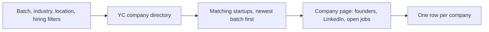

# Y Combinator Company Leads with Founders, LinkedIn and Open Jobs

[](https://apify.com/Turboextract/yc-company-leads)
[](LICENSE)
[](#pricing)

**Get every Y Combinator startup as a clean lead list: website, industry, team size, location, founders with their titles, LinkedIn and X profiles, and open jobs with salary ranges.** Filter by batch, industry, keyword, location or hiring status. Pick the newest batch to reach founders in the weeks after they launch.

The directory covers all 6,398 launched YC companies. The Fall 2026 batch alone has 236 startups, most with 2 to 5 people, a fresh round of funding and a long list of tools still to buy.

**Try it now →** [apify.com/Turboextract/yc-company-leads](https://apify.com/Turboextract/yc-company-leads)

---

## Why this exists

- Every YC batch is 150 to 250 freshly funded startups that need tools, services and hires.
- The YC directory shows founders one company page at a time.
- Founders' LinkedIn and X profiles, team size and open jobs are public but scattered.
- Startup databases charge per seat per month.

---

## Who this is for

- **B2B sales and SDR teams** selling to well-funded early-stage startups
- **Agencies and freelancers** offering design, dev, growth or recruiting to new startups
- **Recruiters** tracking which YC companies are hiring and what they pay
- **Investors and analysts** screening batches by industry and team size
- **Job seekers** looking for early roles at funded startups

---

## What you get per company

```json
{
  "name": "Dualizer",
  "batch": "Fall 2026",
  "status": "Active",
  "oneLiner": "AI-powered physical simulation to design/optimize chemical processes",
  "website": "https://dualizer.com",
  "industry": "B2B",
  "tags": ["Hard Tech", "Machine Learning", "SaaS", "Manufacturing"],
  "teamSize": 3,
  "isHiring": true,
  "locations": "San Francisco, CA, USA",
  "yearFounded": 2026,
  "linkedinUrl": "https://www.linkedin.com/company/dualizer-yc-f26",
  "founders": [
    { "name": "N. L.", "title": "Founder/CEO", "linkedinUrl": "https://www.linkedin.com/in/...", "twitterUrl": "https://x.com/..." },
    { "name": "C. D.", "title": "Founder/CTO", "linkedinUrl": "https://www.linkedin.com/in/..." }
  ],
  "openJobs": [
    { "title": "Simulation Software Developer", "location": "US / Remote (US)", "salaryRange": "$125K - $175K" }
  ],
  "ycUrl": "https://www.ycombinator.com/companies/dualizer"
}
```

Founder names and profile links are shortened in this sample. Runs return them in full.

---

## How it works



The company list comes from the yc-oss open dataset, rebuilt every day from ycombinator.com. Founders and jobs are read from each company's public YC page.

---

## Quick start

1. Click **Try for free**.
2. Set **Batches** to the latest batch, like `Fall 2026`, or set **Latest N batches** to `1` for scheduled runs.
3. Optional: add **Industries** like `Fintech`, tick **Hiring companies only**, or add **Locations**.
4. Click **Start** and export to CSV or your CRM.

### API

```bash
curl -X POST "https://api.apify.com/v2/acts/Turboextract~yc-company-leads/run-sync-get-dataset-items?token=YOUR_TOKEN" \
  -H "Content-Type: application/json" \
  -d '{
    "latestBatches": 1,
    "industries": ["B2B"],
    "maxResults": 300
  }'
```

### Python

```python
from apify_client import ApifyClient

client = ApifyClient("YOUR_TOKEN")
run = client.actor("Turboextract/yc-company-leads").call(run_input={
    "batches": ["Fall 2026", "Summer 2025"],
    "hiringOnly": True,
})
for c in client.dataset(run["defaultDatasetId"]).iterate_items():
    for f in c["founders"]:
        print(c["name"], c["website"], f["name"], f["title"], f["linkedinUrl"])
```

---

## Input fields

| Field | Default | What it does |
|---|---|---|
| `batches` | all | e.g. Fall 2026, S25, W24 |
| `latestBatches` | 0 | Adds the N newest batches |
| `industries` | – | Industry or tag, e.g. Fintech, AI |
| `keywords` | – | Search name, one-liner and description |
| `locations` | – | City, country or region |
| `statuses` | Active | Active, Acquired, Public, Inactive |
| `hiringOnly` | false | Only companies with open jobs |
| `topCompaniesOnly` | false | YC top companies list |
| `minTeamSize` / `maxTeamSize` | 0 | Team size range |
| `includeFounders` | true | Founders, socials and open jobs |
| `maxResults` | 500 | Cap per run |

---

## Pricing

**$0.003 per company delivered, founders included.** A full batch of about 240 startups costs about $0.72.

| Option | 1,000 companies with founders |
|---|---|
| **Y Combinator Company Leads** | **$3** |
| Other YC actors on Apify | $1 to $150, founders or emails often extra |
| Startup databases | Monthly seats |
| Copying the YC directory by hand | Days |

---

## Common use cases

- **Launch-week outreach**: the newest batch, B2B only, founders' LinkedIn for a personal note
- **Hiring signals**: companies with open engineering or sales roles and their salary bands
- **Market maps**: every YC company in a niche like compliance or robotics
- **Recruiting**: startups with 10 to 50 people that are hiring
- **Event invites**: founders in your city from the last two batches

---

## Tips for best results

- Use `latestBatches: 1` on a schedule so the newest batch is picked up automatically.
- Combine `industries` and `keywords` for a tight niche, like B2B plus compliance.
- Turn off `includeFounders` for a fast market count.
- Dedupe on `ycUrl` across runs.

---

## Pairs well with

- [Newly Funded Startup Leads](https://apify.com/Turboextract/startup-funding-leads): companies that just filed an SEC Form D
- [ATS Jobs Feed](https://apify.com/Turboextract/ats-job-feed): every open job from the startup's own career board
- [B2B Lead Enrichment Pipeline](https://apify.com/Turboextract/b2b-lead-enrichment-pipeline): turn the website into phone, socials and a company profile

---

## FAQ

**How fresh is it?** The directory is rebuilt daily from ycombinator.com, and founders and jobs are read live on every run.

**Does it include emails?** No. YC doesn't publish founder emails. You get each founder's LinkedIn and X profile, plus the company website.

**What batch codes work?** Full names like `Summer 2025` or short codes: W = Winter, X = Spring, S = Summer, F = Fall, e.g. `F26`.

**Is it legal?** It uses public company profiles that YC publishes. Follow privacy and anti-spam rules when you contact founders.

---

## SEO keywords

Y Combinator companies list, YC startups database, YC founders list, Y Combinator scraper, YC batch companies, startup leads with founders, YC company directory API, Y Combinator founders LinkedIn, funded startups list, YC hiring companies

---

## Support

- Actor page: https://apify.com/Turboextract/yc-company-leads
- Issues and questions: open an issue in this repo
- Community Discord: https://discord.gg/8SrXSCpvgj

Built and maintained by [Turboextract](https://apify.com/Turboextract) on the Apify platform.

---

## License

The documentation and examples in this repository are MIT licensed. The actor itself runs on the Apify platform.
